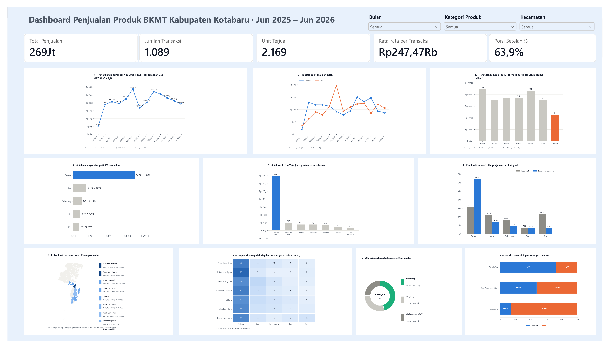
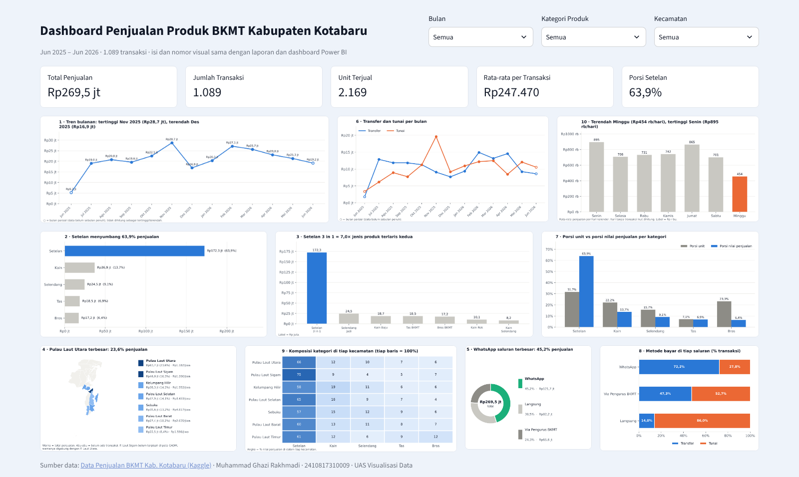

# Dashboard Penjualan Seragam BKMT Kotabaru

UAS Visualisasi Data · Muhammad Ghazi Rakhmadi · 2410817310009 · Teknologi Informasi, Universitas Lambung Mangkurat

> **Dua pertiga omzet datang dari satu produk, dan pasar terbesar di dekat toko justru paling belum tergarap.**



## 1. Problem

Usaha seragam BKMT keluarga penulis mencatat 1.089 transaksi selama setahun, tetapi data itu belum pernah diolah. Keputusan stok, promosi, dan wilayah sasaran masih berdasarkan perkiraan. Proyek ini menjawab empat pertanyaan:

1. Bagaimana perkembangan penjualan per bulan, dan apa penyebab naik-turunnya?
2. Kategori dan jenis produk apa yang paling besar kontribusinya?
3. Kecamatan mana yang besar dan mana yang belum tergarap?
4. Saluran penjualan dan metode pembayaran apa yang dominan, dan apakah saling berkaitan?

## 2. Dataset

| Item | Keterangan |
|---|---|
| Sumber | Data penjualan usaha seragam BKMT keluarga penulis ([Kaggle](https://www.kaggle.com/datasets/mghazirakhmadi/data-penjualan-bkmt-kab-kotabaru)) |
| Jumlah | 1.089 transaksi, 12 kolom, 2.169 unit, Rp269.495.000 |
| Periode | 23 Juni 2025 – 27 Juni 2026 (Juni 2025 & Juni 2026 bulan parsial) |
| Atribut | Tanggal, Kecamatan (7), Kategori (5), Jenis Produk (7), Ukuran, Jumlah, Harga Satuan, Total, Saluran (3), Metode Pembayaran (2) |
| Data tambahan | Penduduk kecamatan (proyeksi BPS 2024), batas kecamatan (GADM 4.1) |
| Kondisi | 0 nilai kosong, 0 duplikat, Total = Jumlah × Harga di semua baris. 58% nama pembeli muncul di lebih dari satu kecamatan, sehingga Nama Pembeli **bukan** ID pelanggan |

## 3. Tools

Python (pandas, SciPy, GeoPandas) untuk pengolahan dan uji statistik · **Power BI Desktop** untuk dashboard utama (10 visual Python/matplotlib) · Streamlit dan HTML + Apache ECharts untuk versi web dashboard · Canva untuk poster · Microsoft Word untuk laporan.

Alur: **Raw → Cleaning → Processing → KPI → Visualization**, ditambah uji pola (permutasi, chi-kuadrat, Kruskal-Wallis) supaya insight tidak berasal dari kebetulan.

## 4. Dashboard

Dashboard berisi **3 slicer** (Bulan, Kategori Produk, Kecamatan), **5 kartu KPI** (total penjualan, transaksi, unit, rata-rata per transaksi, porsi Setelan), dan **10 visualisasi** sesuai Rencana Visualisasi laporan. Nomor visual sama di semua tempat (laporan, Power BI, Streamlit, web, `Gambar Visualisasi/`):

| No. | Visual | Jenis | No. | Visual | Jenis |
|---|---|---|---|---|---|
| 1 | Tren bulanan | Garis | 6 | Transfer vs tunai per bulan | Garis dua seri |
| 2 | Penjualan per kategori | Batang horizontal | 7 | Porsi unit vs porsi nilai | Batang berkelompok |
| 3 | Penjualan per jenis produk | Batang vertikal | 8 | Metode bayar di tiap saluran | Batang bertumpuk 100% |
| 4 | Peta kecamatan | Peta koroplet | 9 | Kategori × kecamatan | Peta panas |
| 5 | Porsi saluran | Donat | 10 | Penjualan per hari | Batang vertikal |

- **Power BI (utama):** [`dashboard/Dashboard.pbix`](dashboard/Dashboard.pbix), ekspor PDF-nya [`dashboard/Dashboard.pdf`](dashboard/Dashboard.pdf). Data tiga tabel, measure DAX, tema, dan 10 skrip visual Python ada di [`powerbi/`](powerbi/), panduannya di [`powerbi/PANDUAN_POWERBI.md`](powerbi/PANDUAN_POWERBI.md). Visual Python butuh Python + pandas + matplotlib di komputer pembuka.
- **Streamlit:** [`streamlit/app.py`](streamlit/app.py) berisi 10 grafik Plotly interaktif (hover, zoom, klik grafik untuk menyaring seluruh dashboard) dengan isi dan nomor visual yang sama seperti Power BI, plus filter multi-pilih dan unduhan CSV. Versi statis lama ada di `streamlit/app_statis.py`. Jalankan di komputer sendiri:
  ```bash
  pip install -r streamlit/requirements.txt
  streamlit run streamlit/app.py
  ```
  Supaya bisa dibuka lewat tautan, unggah repo ke GitHub lalu deploy gratis di [Streamlit Community Cloud](https://share.streamlit.io) dengan *main file path* `streamlit/app.py`.
- **Web statis:** `dashboard/index.html` (HTML + ECharts), isi sama, ditambah tooltip dan klik untuk menyaring. Bisa dibuka langsung di browser atau lewat GitHub Pages.



## 5. Key Insights

| # | Insight | Angka kunci |
|---|---|---|
| 1 | **Setelan 3 in 1 menopang pendapatan.** 63,9% penjualan dari 32,2% transaksi; 61,9% unit berukuran XL ke atas, ukuran M hanya 9,2%. | 63,9% |
| 2 | **Puncak bulanan datang dari pesanan borongan, bukan musim.** Pesanan ≥5 unit = 7,4% transaksi tetapi 22,9% penjualan; 82% selisih Nov–Des 2025 berasal dari borongan. Fluktuasi bulanan tidak berbeda dari acak (p = 0,74). | 7% → 23% |
| 3 | **Pasar terbesar paling belum tergarap.** Pulau Laut Utara terbesar secara rupiah tetapi terendah per penduduk (Rp1.182/jiwa); Sebuku Rp4.817/jiwa. 15 dari 22 kecamatan belum ada transaksi. | 4,1× |
| 4 | **WhatsApp & pengurus = jalur ke luar kota.** Di luar Pulau Laut Utara 82,1% penjualan lewat WhatsApp dan pengurus BKMT; saluran menentukan cara bayar (WhatsApp 72% transfer, langsung 86% tunai). | 82% |
| 5 | **Hari Minggu sepi walau toko buka.** Rp454 rb/hari, 49% di bawah Senin (p < 0,001). | −49% |

## 6. Recommendation

| Prioritas | Rekomendasi | Indikator |
|---|---|---|
| Tinggi | Stok setelan mengikuti pola ukuran (L 29%, XL 29%, XXL 23%, XXXL 10%, M 9%); paket setelan + bros | Tidak ada kehabisan ukuran L–XXL |
| Tinggi | Paket harga kelompok (mulai 5 setelan) lewat pengurus; catat tujuan setiap pesanan borongan | Jumlah & porsi pesanan borongan |
| Sedang | Promosi di Pulau Laut Utara & Sigam; uji 1–2 kecamatan baru lewat pengurus setempat (potensi ±Rp36,6 jt/tahun, skenario) | Penjualan per jiwa PLU & Sigam |
| Sedang | WhatsApp Business, komisi tertulis untuk pengurus, QRIS | Waktu balas chat, porsi nontunai |
| Rendah | Uji broadcast katalog Minggu sore selama 4 minggu | Penjualan Minggu vs rata-rata harian |

## Struktur repository

```
data/raw/            dataset asli (.xlsx)
data/external/       penduduk kecamatan BPS 2024, GeoJSON kecamatan (GADM 4.1)
data/processed/      data bersih, tabel agregasi, ringkasan_uji.json
scripts/             analisis.py (pengolahan + KPI + uji), render_visual.py (10 PNG), build_dashboard.py (web statis)
Gambar Visualisasi/  10 visualisasi PNG (sama dengan dashboard dan laporan)
dashboard/           Dashboard.pbix + Dashboard.pdf (Power BI), index.html + data.js (web statis)
streamlit/           app.py + requirements.txt (dashboard Streamlit)
powerbi/             data, measure DAX, tema, 10 skrip visual Python, panduan
screenshots/         tangkapan layar dashboard Power BI, Streamlit, dan web
laporan/             laporan UAS (.pdf, .docx)
presentasi/          PPT 10 slide
poster/              poster A3
referensi/           PDF 9 artikel jurnal + daftar sumber web daftar pustaka
```

## Menjalankan ulang

```bash
pip install pandas openpyxl scipy matplotlib geopandas streamlit
python scripts/analisis.py          # data/processed + KPI + uji pola
python scripts/render_visual.py     # Gambar Visualisasi/v01–v10 dari skrip visual Power BI
python scripts/build_dashboard.py   # dashboard/data.js + dashboard/index.html
streamlit run streamlit/app.py      # dashboard Streamlit
```

## Sumber data tambahan

- BPS Kabupaten Kotabaru (2025). *Kabupaten Kotabaru Dalam Angka 2025* – proyeksi penduduk kecamatan pertengahan 2024.
- GADM (2022). *GADM database of Global Administrative Areas, version 4.1* – batas kecamatan.
